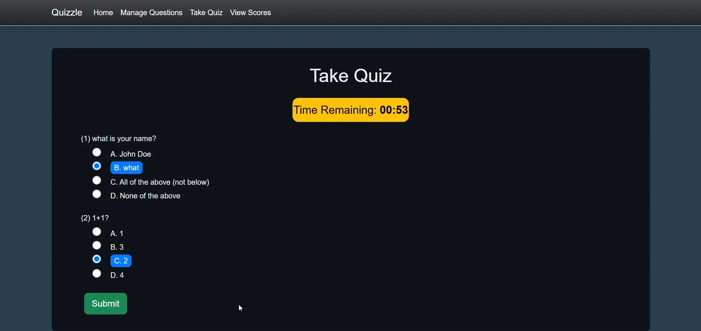

# Quizzle

A quiz app built with ASP.NET Core Razor Pages. Write and edit multiple-choice questions, take a timed quiz, then see your score.



## Features

- Create, edit and delete multiple-choice questions, each with four options and one correct answer. Deleting asks for confirmation.
- Take a quiz of all the questions in a random order, with a one-minute timer. When time runs out, your answers are submitted automatically.
- See your score out of the total straight after submitting. Scores aren't saved between quizzes.

## Tech stack

- C# and ASP.NET Core Razor Pages (.NET 8)
- Entity Framework Core with SQL Server
- Bootstrap and a little JavaScript for the timer

## Run it locally

### Prerequisites

- .NET 8 SDK
- SQL Server
- The EF Core command-line tools: `dotnet tool install --global dotnet-ef`

### Steps

1. Copy `.env.example` to `.env` and set `ConnectionStrings__QuizzleContext` to your SQL Server database.
2. Create the database tables:

   ```sh
   dotnet ef database update
   ```

3. Start the app:

   ```sh
   dotnet run --launch-profile https
   ```

   Then open https://localhost:7058.
